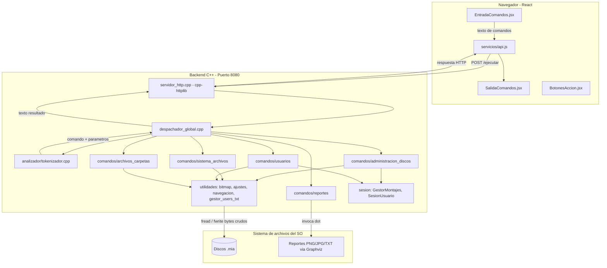
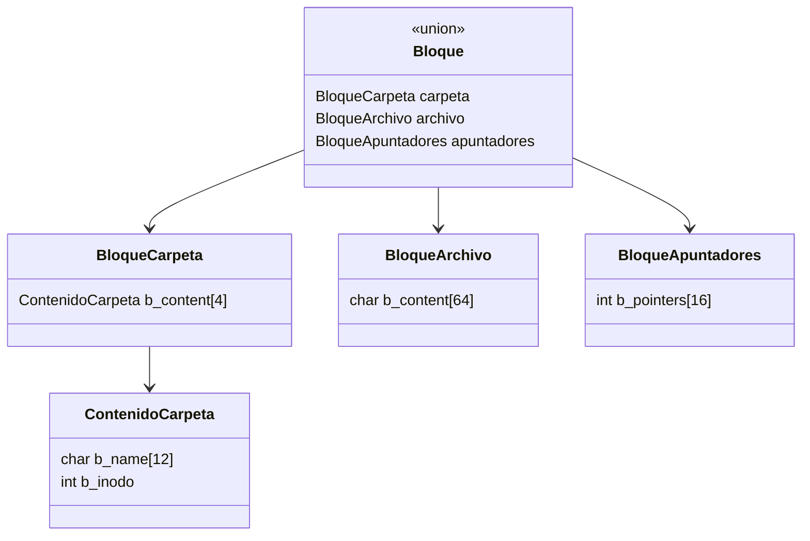
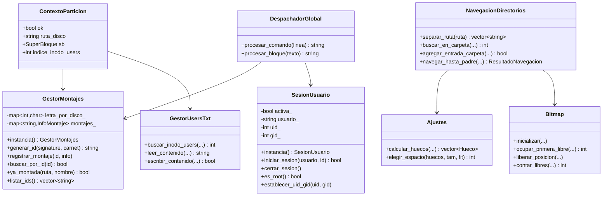
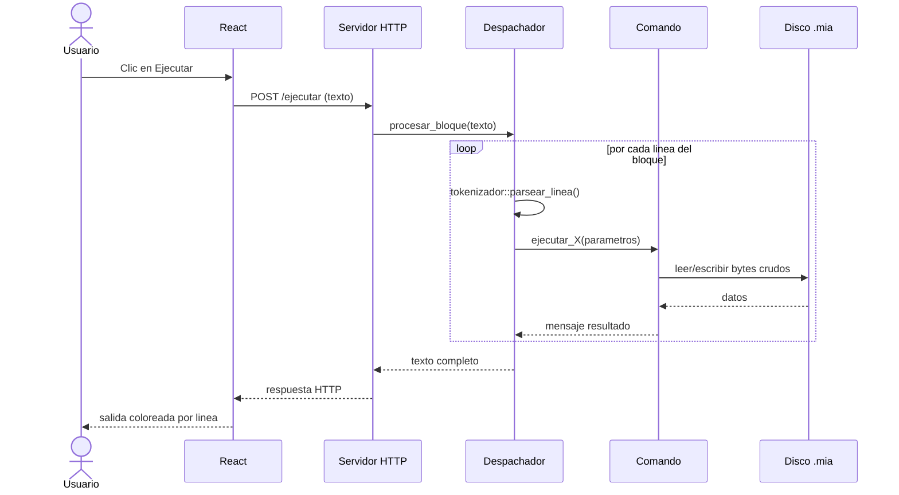
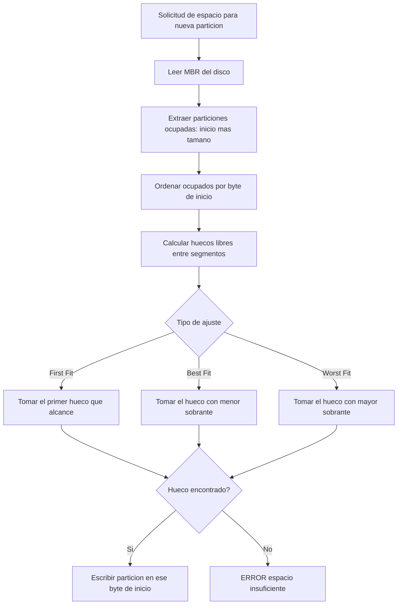
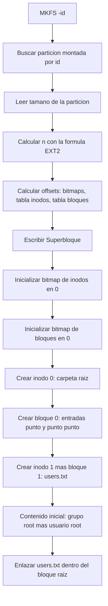
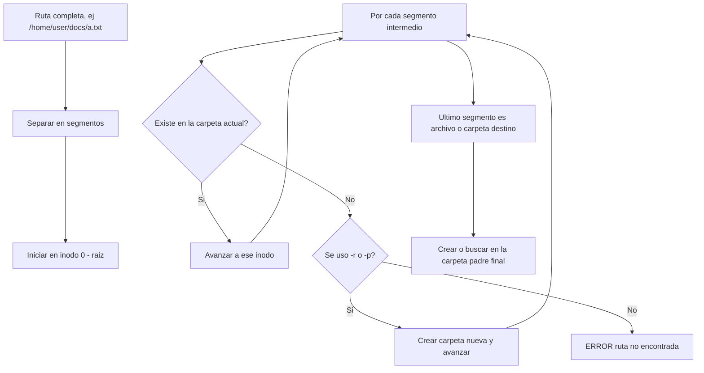
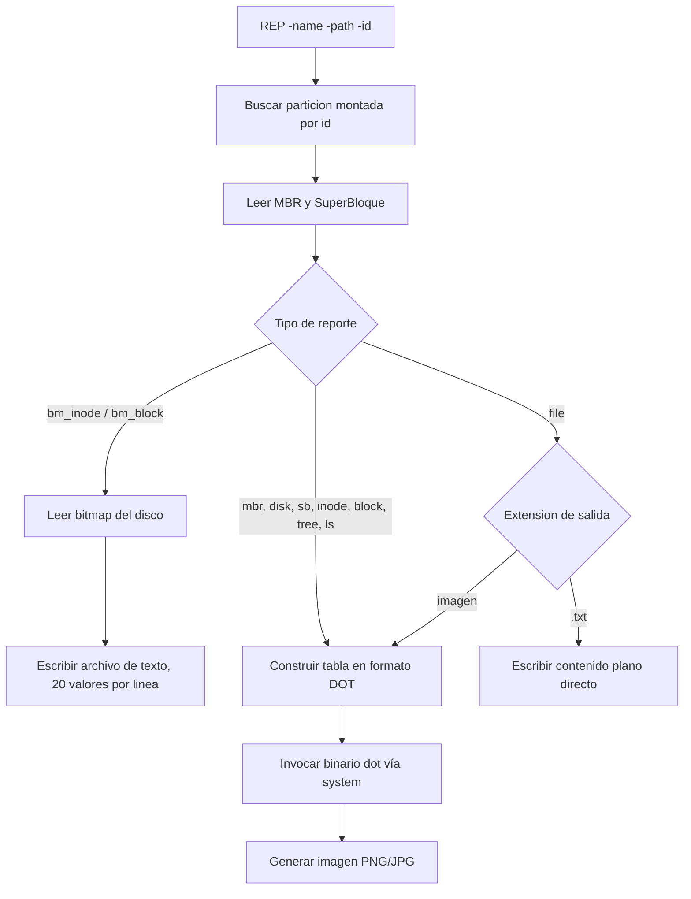
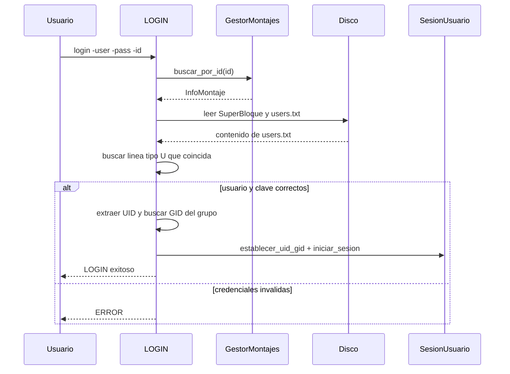

# Manual Técnico — ExtreamFS

**Universidad de San Carlos de Guatemala**


**Facultad de Ingeniería — Ingeniería en Ciencias y Sistemas**

**Manejo e Implementación de Archivos — Proyecto 1: C++ Disk**


|---|---|
| Autor | Jennifer Michelle Rosales Juarez
| Carné | 202400063 |
| Repositorio | MIA_2S2026_P1_202400063 |
| Fecha | 13 de Septiembre 2026 |

---

## Tabla de contenidos

1. Introducción
2. Arquitectura del sistema
3. Estructuras de datos internas
4. Diagrama de clases
5. Flujos de operación
6. Catálogo de comandos
7. API REST
8. Requisitos técnicos y ejecución
9. Consideraciones de diseño y restricciones cumplidas

---

## 1. Introducción

ExtreamFS es una aplicación web que simula el funcionamiento interno de un sistema de archivos **EXT2**, sin depender de hardware físico ni particiones reales del sistema operativo. Toda la simulación ocurre sobre **archivos binarios** con extensión `.mia`, que actúan como discos duros virtuales, sobre los cuales se construyen a mano las estructuras internas de un sistema de archivos real: MBR, EBR, Superbloque, Inodos y Bloques.

El proyecto se compone de dos partes independientes que se comunican por HTTP:

- **Backend (C++):** contiene el 100% de la lógica del sistema de archivos.
- **Frontend (React):** interfaz de usuario tipo terminal para ejecutar comandos y visualizar resultados.

---

## 2. Arquitectura del sistema

*(Captura sugerida: screenshot del frontend corriendo con el indicador "Backend conectado" en verde)*



### Decisiones de arquitectura

| Decisión | Justificación |
|---|---|
| Un solo endpoint `POST /ejecutar` | El formato de entrada/salida ya es texto plano de comandos; no requiere JSON ni múltiples rutas |
| Sesión de usuario y montajes en RAM | El enunciado exige explícitamente que el montaje "no debe escribir esto en el disco" |
| Persistencia en archivos binarios `.mia` | Requisito central: simular un disco real sin hardware físico |
| Sin estructuras en memoria para archivos/carpetas | Restricción explícita del enunciado; toda navegación se hace leyendo el disco en cada operación |
| Graphviz vía `system()` | Evita dependencias de compilación complejas; el binario `dot` cubre el 100% de las necesidades de reportes |
| Frontend sin lógica de negocio | Toda la validación y reglas viven en backend; React solo presenta texto |

---

## 3. Estructuras de datos internas

Todas las estructuras persistidas en disco usan tipos de tamaño fijo (`char[]`, `int`, `time_t`) y se serializan con `reinterpret_cast<char*>` directo a bytes crudos — nunca `std::string`, porque no tiene representación binaria de tamaño fijo.

### 3.1 MBR (Master Boot Record)

Se escribe en el byte 0 de cada disco.

| Campo | Tipo | Descripción |
|---|---|---|
| `mbr_tamano` | int | Tamaño total del disco en bytes |
| `mbr_fecha_creacion` | time_t | Fecha y hora de creación |
| `mbr_dsk_signature` | int | Número aleatorio único por disco |
| `dsk_fit` | char | Ajuste del disco: B/F/W |
| `mbr_partitions[4]` | Partition | Las 4 particiones posibles |

### 3.2 Partition

| Campo | Tipo | Descripción |
|---|---|---|
| `part_status` | char | '0' libre / '1' montada |
| `part_type` | char | 'P' primaria / 'E' extendida |
| `part_fit` | char | Ajuste B/F/W |
| `part_start` | int | Byte de inicio en el disco |
| `part_s` | int | Tamaño en bytes |
| `part_name` | char[16] | Nombre |
| `part_correlative` | int | Orden de montaje (-1 si no montada) |
| `part_id` | char[4] | ID generado al montar |

### 3.3 EBR (Extended Boot Record)

Estructura de lista enlazada que administra particiones lógicas dentro de una extendida.

| Campo | Tipo | Descripción |
|---|---|---|
| `part_mount` | char | Estado de montaje |
| `part_fit` | char | Ajuste B/F/W |
| `part_start` | int | Byte de inicio de la lógica |
| `part_s` | int | Tamaño de la lógica |
| `part_next` | int | Byte del siguiente EBR, -1 si es el último |
| `part_name` | char[16] | Nombre de la lógica |

### 3.4 SuperBloque

Se escribe una sola vez al inicio de cada partición formateada con MKFS.

*(Captura sugerida: reporte `sb.png` real del proyecto)*

| Campo | Tipo | Descripción |
|---|---|---|
| `s_filesystem_type` | int | 2 = EXT2 |
| `s_inodes_count` / `s_blocks_count` | int | Totales calculados |
| `s_free_blocks_count` / `s_free_inodes_count` | int | Disponibles (recalculados en vivo desde el bitmap al generar el reporte) |
| `s_mtime` / `s_umtime` | time_t | Fechas de montaje/desmontaje |
| `s_mnt_count` | int | Veces montado |
| `s_magic` | int | 0xEF53 |
| `s_inode_s` / `s_block_s` | int | Tamaño de cada estructura |
| `s_firts_ino` / `s_first_blo` | int | Primer inodo/bloque libre |
| `s_bm_inode_start` / `s_bm_block_start` | int | Inicio de los bitmaps |
| `s_inode_start` / `s_block_start` | int | Inicio de las tablas |

**Cálculo del número de estructuras (n):**

```
tamaño_particion = sizeOf(superbloque) + n + 3n + n·sizeOf(inodo) + 3n·sizeOf(bloque)
n = floor((tamaño_particion − sizeOf(superbloque)) / (4 + sizeOf(inodo) + 3·sizeOf(bloque)))
número_bloques = 3n
```

### 3.5 Inodo

| Campo | Tipo | Descripción |
|---|---|---|
| `i_uid` / `i_gid` | int | Propietario y grupo |
| `i_s` | int | Tamaño del archivo en bytes |
| `i_atime` / `i_ctime` / `i_mtime` | time_t | Fechas de acceso/creación/modificación |
| `i_block[15]` | int | 12 directos, 1 simple indirecto, 1 doble, 1 triple |
| `i_type` | char | '0' carpeta / '1' archivo |
| `i_perm[3]` | char | Permisos UGO en octal |

### 3.6 Bloques (union de 64 bytes fijos)



Los tres tipos ocupan siempre 64 bytes físicos; solo cambia la interpretación según el `i_type` del inodo dueño — exactamente como un sistema EXT2 real.

### 3.7 Archivo users.txt

Registro lógico almacenado dentro del propio sistema de archivos, en la raíz de cada partición formateada.

| Tipo de registro | Formato |
|---|---|
| Grupo | `GID, G, NombreGrupo` |
| Usuario | `UID, U, Grupo, Usuario, Contraseña` |

Un ID en `0` indica que el registro fue eliminado lógicamente (no se borra la línea, se conserva el historial).

---

## 4. Diagrama de clases (módulos principales del backend)



---

## 5. Flujos de operación

### 5.1 Flujo general de una petición HTTP




### 5.2 Algoritmo de ajuste de espacio (Best / First / Worst Fit)




### 5.3 Flujo de MKFS (formateo EXT2)



### 5.4 Flujo de navegación de rutas (MKFILE / MKDIR / CAT)



### 5.5 Flujo de generación de reportes (REP)



### 5.6 Flujo de autenticación (LOGIN)



---

## 6. Catálogo de comandos

### 6.1 Administración de discos

| Comando | Parámetros | Descripción |
|---|---|---|
| `MKDISK` | `-size*` `-fit` `-unit` `-path*` | Crea disco binario `.mia` lleno de ceros |
| `RMDISK` | `-path*` | Elimina un disco |
| `FDISK` | `-size*` `-unit` `-path*` `-type` `-fit` `-name*` | Crea partición primaria/extendida/lógica |
| `MOUNT` | `-path*` `-name*` | Monta partición, genera ID único |
| `MOUNTED` | (ninguno) | Lista IDs de particiones montadas |

### 6.2 Sistema de archivos EXT2

| Comando | Parámetros | Descripción |
|---|---|---|
| `MKFS` | `-id*` `-type` | Formatea la partición como EXT2 |
| `CAT` | `-file1..N*` | Muestra el contenido concatenado de archivos |

### 6.3 Usuarios y grupos (requieren sesión activa, excepto LOGIN)

| Comando | Parámetros | Descripción |
|---|---|---|
| `LOGIN` | `-user*` `-pass*` `-id*` | Inicia sesión |
| `LOGOUT` | (ninguno) | Cierra sesión |
| `MKGRP` | `-name*` | Crea grupo (solo root) |
| `RMGRP` | `-name*` | Elimina grupo lógicamente (GID=0) |
| `MKUSR` | `-user*` `-pass*` `-grp*` | Crea usuario (solo root) |
| `RMUSR` | `-user*` | Elimina usuario lógicamente (UID=0) |
| `CHGRP` | `-user*` `-grp*` | Cambia el grupo de un usuario |

### 6.4 Archivos y carpetas

| Comando | Parámetros | Descripción |
|---|---|---|
| `MKFILE` | `-path*` `-r` `-size` `-cont` | Crea archivo, opcionalmente recursivo |
| `MKDIR` | `-path*` `-p` | Crea carpeta, opcionalmente recursivo |

### 6.5 Reportes

| Comando | Parámetros | Descripción |
|---|---|---|
| `REP` | `-name*` `-path*` `-id*` `-path_file_ls` | Genera uno de los 10 reportes disponibles |

`*` = parámetro obligatorio

### 6.6 Tipos de reporte (`-name`)

| Valor | Formato de salida | Contenido |
|---|---|---|
| `mbr` | Imagen (Graphviz) | MBR y sus particiones/EBR |
| `disk` | Imagen (Graphviz) | Distribución porcentual del disco |
| `sb` | Imagen (Graphviz) | Superbloque de la partición |
| `inode` | Imagen (Graphviz) | Todos los inodos en uso |
| `block` | Imagen (Graphviz) | Todos los bloques en uso, encadenados por secuencia |
| `bm_inode` | Texto plano | Bitmap de inodos, 20 valores por línea |
| `bm_block` / `bm_bloc` | Texto plano | Bitmap de bloques, 20 valores por línea |
| `tree` | Imagen (Graphviz) | Árbol jerárquico completo |
| `file` | Texto plano si `.txt`, imagen si no | Contenido de un archivo |
| `ls` | Imagen (Graphviz) | Listado detallado de una carpeta |

---

## 7. API REST

**Endpoint único:** `POST http://localhost:8080/ejecutar`

- **Cuerpo:** texto plano con uno o más comandos, uno por línea. Soporta comentarios (`#`) y líneas en blanco, respetando el formato de script `.smia`.
- **Respuesta:** texto plano con el resultado de cada línea, en el mismo orden de entrada.

**Ejemplo de petición:**
```
POST /ejecutar
Content-Type: text/plain

mkdisk -size=10 -unit=M -path=/home/user/disco1.mia
fdisk -size=300 -path=/home/user/disco1.mia -name=Part1
mount -path=/home/user/disco1.mia -name=Part1
```

**Ejemplo de respuesta:**
```
MKDISK: disco creado exitosamente en /home/user/disco1.mia (10485760 bytes, fit=FF)
FDISK: particion primaria 'Part1' creada exitosamente
MOUNT: particion 'Part1' montada exitosamente con id=631A
```

---

## 8. Requisitos técnicos y ejecución

**Requisitos:**
- Distribución GNU/Linux o macOS
- Compilador C++17 (g++/clang)
- CMake ≥ 3.10
- Graphviz (`sudo apt install graphviz`)
- Node.js ≥ 18 y npm

**Compilar backend:**
```bash
cd backend/build
cmake ..
make
```

**Ejecutar backend (modo servidor):**
```bash
./extreamfs servidor
```

**Ejecutar frontend:**
```bash
cd frontend
npm install
npm run dev
```

---

## 9. Consideraciones de diseño y restricciones cumplidas

| Restricción del enunciado | Cómo se cumple |
|---|---|
| El disco no debe cambiar de tamaño | `crear_archivo_disco` escribe el tamaño completo una sola vez en MKDISK; ninguna operación posterior modifica el tamaño del archivo `.mia` |
| No usar estructuras en memoria para archivos/carpetas | Toda navegación (`navegacion_directorios.cpp`) lee y escribe directo sobre el disco en cada llamada, sin cachear ni mantener árboles en RAM |
| No agregar/quitar atributos a las estructuras | Los structs `MBR`, `Partition`, `EBR`, `SuperBloque`, `Inodo` y `Bloque` contienen únicamente los campos definidos en el enunciado |
| Backend exclusivamente en C++ | Todo el procesamiento de comandos y manejo de disco está en C++17; React solo consume la API |
| Montaje en memoria RAM | `GestorMontajes` y `SesionUsuario` son singletons en memoria del proceso, sin persistencia entre reinicios del backend |