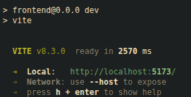
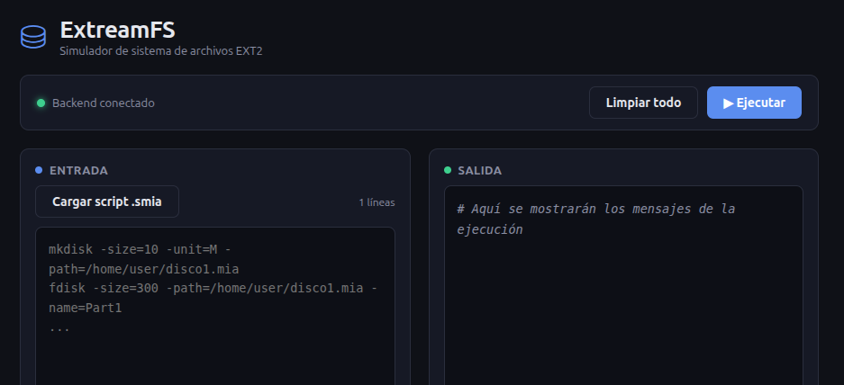
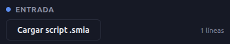
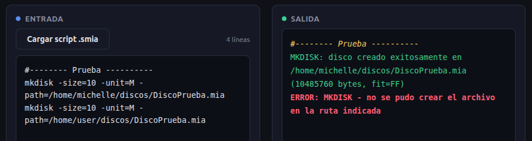
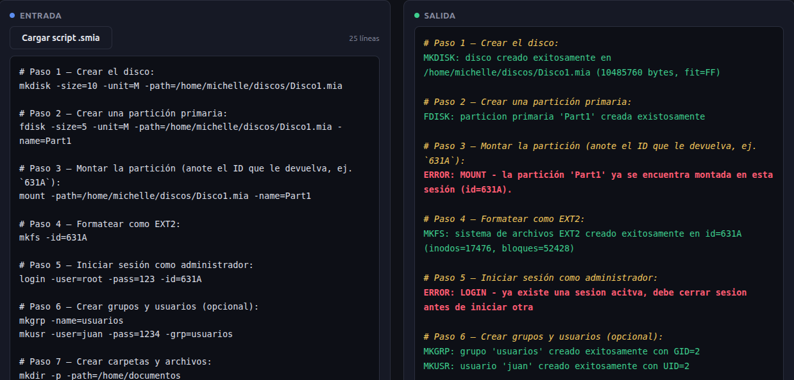
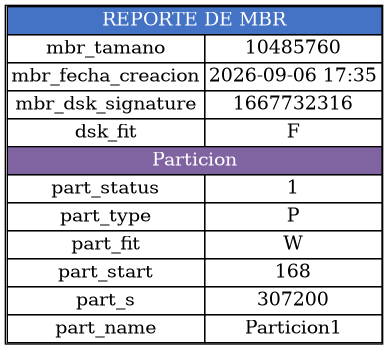
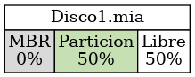
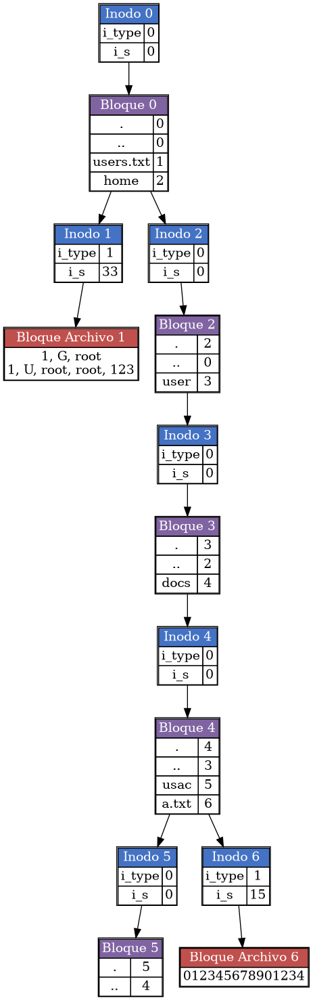

# Manual de Usuario — ExtreamFS

**Universidad de San Carlos de Guatemala**

**Facultad de Ingeniería**

**Ingeniería en Ciencias y Sistemas**

---

## Tabla de contenidos

1. Requisitos previos
2. Cómo iniciar la aplicación
3. Descripción de la interfaz
4. Escribir comandos manualmente
5. Cargar un script .smia
6. Ejecutar comandos e interpretar resultados
7. Flujo típico de uso completo
8. Cómo generar y leer reportes
9. Solución de problemas comunes
10. Referencia rápida de comandos

---

## 1. Requisitos previos

Antes de usar la aplicación, asegúrese de tener instalado:

- Una distribución de Linux (o macOS)
- Graphviz: `sudo apt install graphviz`
- Node.js y npm (para el frontend)
- El proyecto ya compilado (ver sección 2)

---

## 2. Cómo iniciar la aplicación

Necesita dos terminales abiertas al mismo tiempo.

**Terminal 1 — Backend:**
```bash
cd backend/build
./extreamfs servidor
```
Debe ver el mensaje: `Servidor escuchando en http://localhost:8080`

**Terminal 2 — Frontend:**
```bash
cd frontend
npm run dev
```
Copie la dirección que le indique (usualmente `http://localhost:5173`) y ábrala en su navegador.



---

## 3. Descripción de la interfaz

Al abrir la aplicación encontrará:

- **Encabezado:** nombre de la aplicación y un indicador de estado de conexión con el backend (verde = conectado, rojo = no disponible).
- **Barra de acciones:** botones "Limpiar todo" y "Ejecutar".
- **Panel de Entrada (izquierda):** donde se escriben o cargan los comandos.
- **Panel de Salida (derecha):** donde aparecen los resultados, coloreados según su tipo.



---

## 4. Escribir comandos manualmente

1. Haga clic dentro del panel **Entrada**.
2. Escriba un comando por línea, por ejemplo:
```
mkdisk -size=10 -unit=M -path=/home/usuario/discos/Disco1.mia
```
3. Puede agregar comentarios iniciando la línea con `#`; estos se mostrarán tal cual en la salida.


---

## 5. Cargar un script .smia

Si ya tiene un archivo con extensión `.smia` con varios comandos:

1. Presione el botón **"Cargar script .smia"**.
2. Se abrirá el explorador de archivos de su sistema operativo.
3. Seleccione el archivo deseado.
4. El contenido completo se cargará automáticamente en el panel de Entrada, reemplazando lo que hubiera antes.



---

## 6. Ejecutar comandos e interpretar resultados

Presione el botón **▶ Ejecutar**. Mientras se procesa, el botón mostrará "Ejecutando...".

El panel de Salida mostrará el resultado de cada línea, con el siguiente código de colores:

| Color | Significado |
|---|---|
|  Verde | Comando ejecutado con éxito |
|  Rojo | Error (parámetro faltante, recurso no encontrado, permiso denegado, etc.) |
|  Amarillo/cursiva | Comentario del script (línea que inicia con `#`) |
|  Blanco | Texto plano de resultado (por ejemplo, contenido mostrado por `CAT`) |



---

## 7. Flujo típico de uso completo

A continuación, la secuencia mínima para crear un sistema de archivos funcional desde cero:

**Paso 1 — Crear el disco:**
```
mkdisk -size=10 -unit=M -path=/home/usuario/discos/Disco1.mia
```

**Paso 2 — Crear una partición primaria:**
```
fdisk -size=5 -unit=M -path=/home/usuario/discos/Disco1.mia -name=Part1
```

**Paso 3 — Montar la partición** (anote el ID que le devuelva, ej. `631A`):
```
mount -path=/home/usuario/discos/Disco1.mia -name=Part1
```

**Paso 4 — Formatear como EXT2:**
```
mkfs -id=631A
```

**Paso 5 — Iniciar sesión como administrador:**
```
login -user=root -pass=123 -id=631A
```

**Paso 6 — Crear grupos y usuarios (opcional):**
```
mkgrp -name=usuarios
mkusr -user=juan -pass=1234 -grp=usuarios
```

**Paso 7 — Crear carpetas y archivos:**
```
mkdir -p -path=/home/documentos
mkfile -path=/home/documentos/notas.txt -size=50
```

**Paso 8 — Verificar el contenido:**
```
cat -file1=/home/documentos/notas.txt
```



---

## 8. Cómo generar y leer reportes

Los reportes le permiten visualizar el estado interno del disco. Se generan con el comando `REP`:

```
rep -id=631A -path=/home/usuario/reportes/mi_reporte.png -name=disk
```

**Parámetros:**
- `-id`: el ID de la partición montada.
- `-path`: ruta y nombre del archivo de salida. La extensión determina el formato (`.png`, `.jpg` para imágenes; `.txt` para bitmaps y el reporte `file`).
- `-name`: tipo de reporte a generar (ver tabla abajo).
- `-path_file_ls`: solo para los reportes `file` y `ls`, indica la ruta del archivo o carpeta a inspeccionar.

| Tipo (`-name`) | Qué muestra |
|---|---|
| `mbr` | Estructura del MBR y sus particiones |
| `disk` | Distribución porcentual del espacio del disco |
| `sb` | Información del Superbloque de la partición |
| `inode` | Todos los inodos en uso |
| `block` | Todos los bloques en uso, con flechas mostrando su secuencia |
| `bm_inode` | Bitmap de inodos (texto) |
| `bm_block` | Bitmap de bloques (texto) |
| `tree` | Árbol completo de carpetas y archivos |
| `file` | Contenido de un archivo específico |
| `ls` | Listado de una carpeta con permisos, propietario, tamaño y fecha |

Una vez generado, abra el archivo resultante con el visor de imágenes o editor de texto de su sistema operativo.





---

## 9. Solución de problemas comunes

| Problema | Causa probable | Solución |
|---|---|---|
| El indicador muestra "Backend no disponible" | El servidor C++ no está corriendo | Ejecute `./extreamfs servidor` en una terminal |
| "No existe ninguna partición montada con el id..." después de reiniciar el backend | Las particiones montadas se guardan en memoria RAM y se pierden al reiniciar el proceso | Vuelva a ejecutar `mount` para obtener un nuevo ID |
| Un reporte de imagen no se genera | Graphviz no está instalado | Ejecute `sudo apt install graphviz` |
| Los cambios que hice al código no se reflejan al probar | El servidor anterior sigue corriendo con el código viejo | Detenga el proceso (`pkill extreamfs`) y vuelva a iniciarlo después de compilar |
| "No existe una sesión activa" | Intentó usar un comando que requiere estar logueado, sin haber hecho `login` | Ejecute `login -user=... -pass=... -id=...` primero |

---

## 10. Referencia rápida de comandos

```
mkdisk -size=<num> [-fit=BF|FF|WF] [-unit=K|M] -path=<ruta>
rmdisk -path=<ruta>
fdisk -size=<num> [-unit=B|K|M] -path=<ruta> [-type=P|E|L] [-fit=BF|FF|WF] -name=<nombre>
mount -path=<ruta> -name=<nombre>
mounted
mkfs -id=<id> [-type=Full]
login -user=<usuario> -pass=<clave> -id=<id>
logout
mkgrp -name=<nombre>
rmgrp -name=<nombre>
mkusr -user=<usuario> -pass=<clave> -grp=<grupo>
rmusr -user=<usuario>
chgrp -user=<usuario> -grp=<grupo>
cat -file1=<ruta> [-file2=<ruta> ...]
mkfile -path=<ruta> [-r] [-size=<num>] [-cont=<ruta_local>]
mkdir -path=<ruta> [-p]
rep -name=<tipo> -path=<ruta_salida> -id=<id> [-path_file_ls=<ruta>]
```